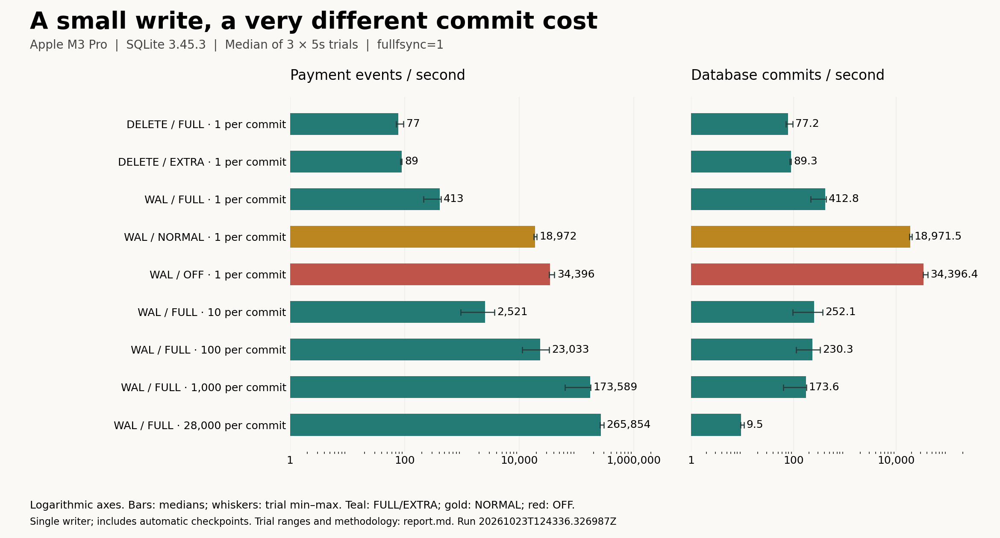
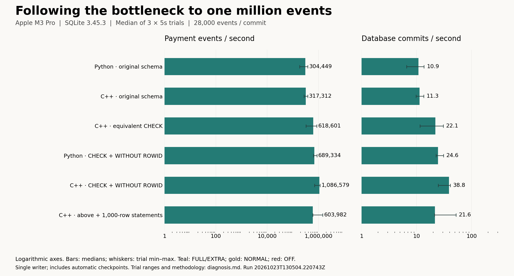

# Why a Tiny Database Write Can Take So Long

*What payment events teach us about disk writes, durability, WAL, and the meaning of “one million transactions per second.”*

Imagine a service that records payment events. Each event contains an ID, an amount, and a status. The payload is tiny. The server has spare CPU capacity. Yet the database processes only a few hundred writes per second.

Where does the time go?

Before adding workers or buying a bigger machine, examine what the service promises when it responds with “success.” A database may spend more time making that promise reliable than changing the data itself.

This article is inspired by Tanay Karnik / Foo Community's [The Physics of Database Speed: from 300 to 1M transactions per second](https://foo.community/blog/the-physics-of-database-speed/). The video uses an account-transfer workload. I built a separate payment-event benchmark and ran it on my own machine. The results below are from that experiment; hypothetical calculations are labeled separately.

## Start with the promise behind COMMIT

Suppose our service records an event:

```sql
INSERT INTO payment_events (event_id, amount_minor, status)
VALUES ('evt_1042', 2500, 'captured');
```

The amount uses integer minor units: 2,500 fils represents AED 25.00. This records an event; it is not a complete payment-processing design.

Now suppose the service returns success, then the machine immediately loses power. Should that event still exist after restart?

If yes, the database needs a durable record before acknowledging the commit. If the event can be recovered from another source, the application may accept a different trade-off. A throughput comparison needs to say which requirement it measures.

## The operating system can accept a write before storage finishes it

In a typical buffered I/O path, writing bytes to a file first puts them in the operating system's page cache. The kernel can send them to storage later. This helps combine work, but cached bytes are not automatically safe against power loss.

On Linux, `fsync()` requests persistence of modified file data and relevant metadata and waits for completion. A database may use `fdatasync()` or a platform-specific mechanism. Synchronizing a file also does not necessarily synchronize its containing directory. The filesystem and device must honor the requests. [Linux fsync documentation](https://man7.org/linux/man-pages/man2/fsync.2.html)

For the payment service, the expensive interval may be between “the operating system received the bytes” and “the commit can safely be acknowledged.”

## A millisecond becomes a throughput limit

Consider a deliberately simplified model:

- Processing one event takes 5 microseconds.
- Making its commit durable takes 1 millisecond.
- One worker processes and commits events sequentially.

These are illustrative assumptions, not measurements.

Each event takes approximately 1.005 milliseconds, giving `1 / 0.001005 ≈ 995 events/second`. Make the processing code twice as fast and the rate becomes roughly 998 events/second.

We doubled the speed of the code and barely changed throughput. The worker is spending most of its time elsewhere.

This is not a universal storage limit. Concurrency, shared flushes, different devices, and database architecture change the result. It explains why spare CPU does not automatically imply a faster sequential commit path.

## The database also has to survive a partially completed write

Inserting an event can modify multiple table and index pages. A crash could interrupt those changes halfway through.

SQLite's rollback journal stores original page contents before overwriting them. Recovery can use those originals to undo an incomplete transaction. Ordered writes and synchronization make that recovery information available when needed. The precise synchronization count depends on the configuration, filesystem, and optimizations. [SQLite atomic commit](https://www.sqlite.org/atomiccommit.html)

A tiny row therefore creates more work than simply copying its values into a file.

## WAL changes where committed changes live

SQLite's write-ahead logging mode appends changed pages to a WAL file. A commit record identifies a completed transaction. Checkpointing later transfers changes to the main database.

Readers consult both files to find the appropriate page versions. Readers and a writer can proceed concurrently, although SQLite still allows only one writer at a time. A committed event can be durable in the WAL before its changed pages reach the main file. [SQLite WAL](https://www.sqlite.org/wal.html)

WAL changes the write path; it does not eliminate the durability requirement.

## A faster acknowledgment can change the failure guarantee

In WAL mode, the synchronization settings make the trade-off visible:

| Setting | Consequence |
|---|---|
| FULL | Synchronizes the WAL at commit, subject to a functioning storage stack. |
| NORMAL | Preserves consistency, but machine failure can lose recent acknowledged transactions. |
| OFF | Machine failure can cause corruption as well as lost data. |

These settings behave differently in rollback-journal mode. `DELETE/FULL` has filesystem-dependent durability; `DELETE/EXTRA` also synchronizes the directory after deleting the journal. Application crashes and machine failures are different cases. A checkpoint page threshold does not establish a time-based loss bound. [SQLite synchronous](https://www.sqlite.org/pragma.html#pragma_synchronous)

My machine runs macOS, so the benchmark explicitly enables `fullfsync` to request `F_FULLFSYNC`; SQLite defaults that flag to off. The report records this separately from `synchronous`. Reading back the flag does not prove that the hardware honored the request. [SQLite fullfsync](https://www.sqlite.org/pragma.html#pragma_fullfsync)

For a rebuildable projection, replaying a durable upstream log may be acceptable. For an authoritative record that triggers an irreversible external action, losing an acknowledged event could violate the contract. PostgreSQL's asynchronous commit documentation discusses this same application-level concern, with guarantees specific to PostgreSQL. [PostgreSQL asynchronous commit](https://www.postgresql.org/docs/current/wal-async-commit.html)

## Share the commit cost across more useful work

Suppose events are already waiting in a durable upstream source. We can insert a bounded group inside one transaction:

```sql
BEGIN;
INSERT INTO payment_events VALUES ('evt_1042', 2500, 'captured');
INSERT INTO payment_events VALUES ('evt_1043', 1800, 'captured');
COMMIT;
```

The inserts share a commit boundary. A failure rolls back the group.

Using the hypothetical 5-microsecond processing cost and 1-millisecond fixed commit cost:

```text
events/second ≈ B / (B × 5 microseconds + 1 millisecond)
```

| Events per transaction | Modeled transaction time | Modeled events/second |
|---:|---:|---:|
| 1 | 1.005 ms | 995 |
| 10 | 1.05 ms | 9,524 |
| 100 | 1.5 ms | 66,667 |
| 1,000 | 6 ms | 166,667 |

These arithmetic examples exclude batch formation, growing I/O, contention, and checkpoint work. Batching amortizes a fixed cost without requiring a weaker synchronization setting. The trade-offs include time waiting to fill the batch and more work sharing one failure boundary.

Application batching and database group commit are different. Batching combines operations into one transaction. Group commit lets separate transactions share a WAL flush while retaining separate boundaries. PostgreSQL can do this without an explicit commit delay. [PostgreSQL WAL configuration](https://www.postgresql.org/docs/current/wal-configuration.html)

## What I measured on my machine

The companion benchmark runs with Python's standard library and SQLite. My first run used:

- Apple M3 Pro, 11 logical CPUs, 18 GiB RAM.
- macOS 27.0.1, APFS on an SSD, approximately 11.7 GiB free at the start.
- CPython 3.13.0 and SQLite 3.45.3.
- One process, one connection, one sequential writer, and no concurrent readers.
- A text primary-key index, integer amount, status, and two CHECK constraints.
- `fullfsync=ON`, 4 KiB pages, an 8 MiB cache target, and automatic WAL checkpointing at 1,000 pages.

Each configuration ran three times for at least five measured seconds, with a quarter-second warmup per trial. Each trial used a fresh database; configuration order was shuffled for each repetition. Rates below are medians, with min–max ranges shown because the variation was substantial.

| Configuration | Events per commit | Events/sec | Min–max events/sec | Commits/sec |
|---|---:|---:|---:|---:|
| DELETE / FULL | 1 | 77 | 71–96 | 77.2 |
| DELETE / EXTRA | 1 | 89 | 85–90 | 89.3 |
| WAL / FULL | 1 | 413 | 214–428 | 412.8 |
| WAL / NORMAL | 1 | 18,972 | 18,024–20,180 | 18,971.5 |
| WAL / OFF | 1 | 34,396 | 33,154–41,122 | 34,396.4 |
| WAL / FULL | 10 | 2,521 | 952–3,694 | 252.1 |
| WAL / FULL | 100 | 23,033 | 11,216–33,029 | 230.3 |
| WAL / FULL | 1,000 | 173,589 | 62,686–176,360 | 173.6 |
| WAL / FULL | 28,000 | 265,854 | 256,712–298,836 | 9.5 |

[Full run report](../results/20261023T124336.326987Z/report.md) · [Raw trial data](../results/20261023T124336.326987Z/results.json) · [Benchmark code](../benchmark.py)



All 27 trials passed row-count and integrity checks after a clean close and reopen. This checks the implementation's accounting and the resulting database; it does not demonstrate power-loss durability.

The timed loop includes event generation, Python/SQLite calls, index maintenance, constraints, transaction work, automatic checkpoints, and instrumentation. Setup, warmup, the final explicit checkpoint, and verification are outside the throughput window. The final checkpoint is timed separately in the raw results.

Background applications were not controlled. The reversal between DELETE/FULL and DELETE/EXTRA is a reason to avoid interpreting every short-run difference as a causal improvement. The WAL/FULL single-event trials ranged from 214 to 428 events/sec. These are local observations under the recorded conditions, not maximum-capacity claims.

A follow-up extended the 1,000-event WAL/FULL configuration to three 30-second trials, with a one-second warmup each. It reached a median of **174,491 events/sec**, ranging from **164,683 to 179,177**, at approximately 174.5 commits/sec. This supports the short-run batching observation over a longer window, while still being a write-only local experiment. [Longer-run report](../results/20261023T124734.578770Z/report.md)

## Did the initial run reach one million TPS?

No. The largest median rate in this matrix was about **266,000 payment events per second**. At 28,000 events per database transaction, that means about **9.5 committed transactions per second**.

The video's reported million-transfer rate at a batch size of 28,000 corresponds to approximately `1,000,000 / 28,000 = 35.7` committed batches per second. Its workload and environment differ from mine. The [creator's published chapter breakdown](https://foo.community/blog/the-physics-of-database-speed/) is the source for its reported milestone, not evidence that this repository reproduced it.

“TPS” needs a defined numerator. A payment event, an account transfer, an SQL statement, and a committed database transaction are different units of work.

The useful result here is that batching raised event throughput while retaining WAL/FULL. It also changed latency and transaction size. With 1,000 events per commit, the median of trial batch-p99 values was 16.900 ms. At 28,000 it was 192.575 ms. Those timings begin at batch generation and end at commit return; they omit time waiting for incoming events to assemble a batch.

## Following the bottleneck to one million events

Was the remaining gap caused by my hardware or by Python? I added a C++ implementation and made it load the exact SQLite binary used by Python. Both drivers generate events inside the timed loop and use the same text IDs, amounts, status values, batch size, and requested synchronization policy.

Changing the language alone barely moved the median in this comparison: Python reached 304,449 events/sec and C++ reached 317,312. The ranges were wide enough that this small difference should not be overinterpreted.

The next finding was in the initial harness's own schema. On SQLite 3.45.3, `EXPLAIN` for the status constraint `CHECK (status IN ('captured', 'refunded', 'failed'))` showed an `OpenEphemeral` operation and three `IdxInsert` operations building a temporary membership structure. Rewriting it as the equivalent `CHECK (status = 'captured' OR status = 'refunded' OR status = 'failed')` removed those operations. Tests verified the accepted status values and rejection of invalid values.

I also tested `WITHOUT ROWID`. The original text primary key required a separate index alongside the rowid table. This alternative stores the table using its declared primary key, avoiding that duplication. It changes physical storage and has API differences, so it is an explicit schema choice. [SQLite WITHOUT ROWID](https://www.sqlite.org/withoutrowid.html)

Here are the medians from three five-second trials per variant. All rows keep WAL/FULL, fullfsync=ON, and 28,000 events per transaction:

| Driver and schema | Events/sec | Min–max events/sec |
|---|---:|---:|
| Python, original | 304,449 | 184,323–383,365 |
| C++, original | 317,312 | 273,131–378,414 |
| C++, equivalent OR check | 618,601 | 322,880–855,244 |
| Python, OR check + WITHOUT ROWID | 689,334 | 631,715–861,850 |
| C++, OR check + WITHOUT ROWID | **1,086,579** | 694,825–1,149,319 |

The optimized C++ median crossed one million **events** per second, with about **38.8 commits per second**. Python also improved substantially after the schema changes. The result demonstrates that this machine can cross the million-event threshold under these conditions; it does not show that changing languages alone produces that rate.



[Raw comparison and phase timings](../results/diagnosis-20261023T130504.220743Z/diagnosis.json) · [Full report](../results/diagnosis-20261023T130504.220743Z/diagnosis.md) · [Native source](../native_benchmark.cpp)

I also tried 1,000 rows per prepared SQL statement. That variant produced an individual trial above 1.45 million events/sec but a median of only 603,982 across three trials. The higher single result is not a reason to present it as the winner. Commit-phase time varied substantially, and includes checkpoint work as well as synchronization.

Longer runs changed the picture. On October 24, three 30-second trials of the optimized C++ implementation with 28,000 events per transaction produced a **904,812 events/sec median**, ranging from 786,534 to 1,011,167. The commit/checkpoint phase occupied a median 49.3% of wall time. The five-second million-event result was reproducible as a short-run observation, but did not establish a consistently sustained million at this batch size. [Longer native run](../results/diagnosis-20261024T103544.282082Z/diagnosis.md)

I then increased the transaction size to **112,000 events**, keeping the same optimized C++ insert path, equivalent constraints, WAL/FULL, and fullfsync settings. All three 30-second trials exceeded a million:

| Trial | Payment events/sec |
|---|---:|
| 1 | 1,003,464 |
| 2 | 1,225,748 |
| 3 | 1,057,639 |
| Median | **1,057,639** |

That is approximately **9.44 database commits/sec**. The change amortizes transaction overhead across more events; it also makes each transaction larger. The final explicit checkpoint remains outside the throughput timer, while automatic checkpoints remain enabled inside it. [Full report and saved measurements](../results/diagnosis-20261024T103845.312724Z/diagnosis.md)

This answers the hardware question narrowly: my machine demonstrated more than a million inserted payment events/sec for these three longer trials. It does not guarantee that rate for an arrival-driven payment service. The machine had substantial background load, so the experiment also does not establish its maximum capacity.

## Once commit waits shrink, other costs become visible

The hypothetical 5-microsecond processing cost implies a sequential ceiling of 200,000 events/sec, even with no commit overhead. That ceiling belongs to the model. It does not constrain this measured workload, whose processing cost was not assumed or measured to be 5 microseconds.

In a real service, serialization, indexes, constraints, locks, or network overhead may become limiting. This harness does not isolate each cost, count synchronization calls, or establish that the CPU is the remaining bottleneck.

Checkpointing also remains work. Long-lived readers can prevent a WAL checkpoint from progressing far enough to reset the log. A write-only benchmark does not characterize that mixed workload. [SQLite checkpointing](https://www.sqlite.org/wal.html#checkpointing)

## Reads need a separate investigation

A faster commit path does not fix a query that scans millions of rows. If an expanded service adds `account_id` and `created_at`, a recent-events query might benefit from an index beginning with those columns:

```sql
SELECT event_id, amount_minor, status
FROM payment_events
WHERE account_id = 'ACC-001'
ORDER BY created_at DESC
LIMIT 50;
```

Those columns are not part of this benchmark's minimal schema. That example requires its own representative data and query-plan check. Indexes provide access paths; the planner chooses how to retrieve and order the rows. [SQLite query planning](https://www.sqlite.org/queryplanner.html)

## Measure the service you intend to run

For a service benchmark, record events/sec and commits/sec separately, arrival-to-acknowledgment p95/p99, batch size and waiting policy, failure guarantees, indexes, concurrent traffic, and behavior over a longer run.

This repository provides a starting point with machine details, repeated measurements, WAL size samples, and reproducible commands. It does not replace an arrival-driven service test or a controlled failure experiment.

The question behind a slow write is often simple: what must be true before we are willing to tell the caller it succeeded?

The answer determines which optimizations preserve the promise and which ones change it.

*Credit: Tanay Karnik / Foo Community provided the inspiration. All local measurements link to saved run artifacts; the mathematical examples are hypothetical.*
